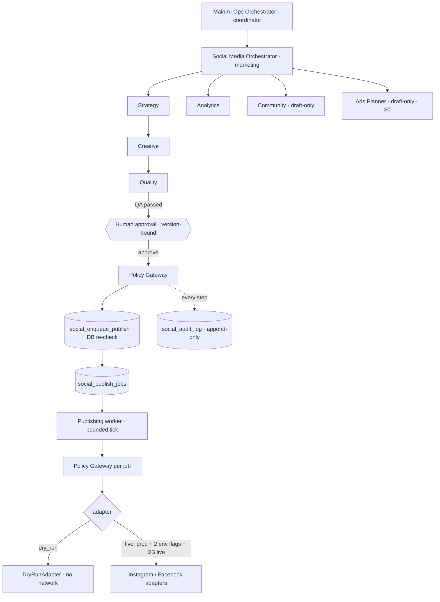

# SamoSell Social Media Agent OS v1.0

**სტატუსი:** Preview / QA. Production-ზე **არაფერი** არ არის გაშვებული. არცერთი რეალური პოსტი არ გამოქვეყნებულა, არცერთი თანხა არ დახარჯულა.
**Branch:** `preview/social-media-agent-os-20261106` · **Production verdict:** `NOT READY` (Meta-ს token-ები და live smoke test აკლია — იხ. §10).

---

## 1. სავალდებულო პოლიტიკა და სად არის ის აღსრულებული

| პოლიტიკა | მნიშვნელობა | აღსრულება (defense in depth) |
|---|---|---|
| Instagram | enabled (target) | `SOCIAL_POLICY.platforms`, `social_control.instagram_enabled`, Policy Gateway |
| Facebook | enabled (target) | იგივე |
| TikTok | disabled | Gateway `platform_disabled_tiktok`; DB `CHECK (tiktok_enabled = false)`; `platforms <@ {instagram,facebook}` |
| Approval mode | `paid` | DB `CHECK (approval_mode in ('paid'))`; ორგანულ პოსტს სჭირდება ადმინის დამტკიცება სანამ auto-publish გამორთულია |
| Daily Ads budget | **$0** | `CHECK (daily_ads_budget_usd = 0)` control-ზე და ad draft-ებზე; Gateway `ads_budget_must_be_zero` |
| Paid Ads create / activate / spend modify | forbidden | Gateway: 4 action ყოველთვის `deny paid_ads_forbidden` ნებისმიერი actor-ით; DB `CHECK (... = false)`; **კოდში საერთოდ არ არსებობს Marketing API-ის write call**; social token-ს არ ეძლევა `ads_management` |
| Organic auto-publishing | target enabled, Production-ზე საწყისად **disabled** | DB default `false`; Gateway კრძალავს Production-ზე ჩართვას სანამ live rollout არ დასრულდება |
| Initial execution mode | **dry-run** | env ceiling + DB `execution_mode` default; ეფექტური რეჟიმი = ორივეს უფრო მკაცრი |

**Approval mode „paid" ინტერპრეტაცია (დაშვება, დასადასტურებელი):** ფასიან მოქმედებებს ყოველთვის სჭირდება დამტკიცება — v1-ში ისინი საერთოდ აკრძალულია. ორგანულ პოსტებს დამტკიცება სჭირდება მანამ, სანამ `organic_auto_publish` გამორთულია (Production-ის საწყისი მდგომარეობა).

## 2. არსებული სისტემის აუდიტი (რა დამხვდა)

**დადასტურებული (კოდით/ბაზით):**
- `lib/ai-ops/*` — Main Orchestrator-ის საფუძველი: role catalog (`coordinator`, `marketing`, …), deny-by-default `authorizeAgentAction`, job state machine, audit validator. **აგენტების executor არ არსებობს.**
- `ai_ops_jobs / ai_ops_activity / ai_ops_approvals / ai_ops_control` — არსებობს **მხოლოდ QA-ზე** (`ydocqjdjmffysexkzxyc`). Production-ზე ეს ცხრილები **არ არის** (შემოწმდა `information_schema`-ით), მიუხედავად იმისა, რომ `supabase/migrations/20261017170000_ai_ops_foundation.sql` main-შია → migrations ხელით ეშვება, ავტომატურად არა.
- QA shadow worker (`supabase/qa/ai_ops_shadow_*.sql`) — დეტერმინისტული, AI-ს გარეშე.
- Meta: `lib/growth/meta-spend-*` — **მხოლოდ კითხულობს** Ads spend-ს (`ads_read` token: `META_ADS_ACCESS_TOKEN`). Meta CAPI/pixel — ცალკე. Organic publishing ან OAuth flow **არ არსებობდა**.
- Feature branches: `feature/growth-agent-v1`, `feature/admin-agent-*`, `preview/muse-spark-admin-agent-*` და სხვ. — social publishing-ის იმპლემენტაცია არცერთში არ მოიძებნა (ძიება `graph.facebook`, `META_`, `media_publish`).

**დუბლირების თავიდან აცილება:** `ai_ops_jobs` ზოგადი shadow queue-ა, `kind`-ზე CHECK constraint-ით და payload-ის გარეშე; მისი გაფართოება არსებულ QA worker-ს შეცვლიდა. ამიტომ publishing queue ცალკეა (`social_publish_jobs`) — პლატფორმა, external id, container id, lease token, needs_review. გამოყენებულია იგივე პატერნები (idempotency key, lease, SKIP LOCKED, append-only log, admin-only RLS, kill switch). AI Ops role catalog **არ შეცვლილა**; Social Orchestrator რეგისტრირებულია როგორც `coordinator → marketing` (`SOCIAL_ORCHESTRATOR`).

## 3. არქიტექტურა

| ფაილი | როლი |
|---|---|
| `lib/social/policy-gateway.ts` | ერთადერთი ავტორიზაციის წერტილი (21 action × 10 actor, deny by default) |
| `lib/social/runtime.ts` | გარემოს რეზოლუცია: backend allowlist, live ceiling — fail closed |
| `lib/social/orchestrator.ts` | Planning cycle, QA, approve→enqueue, reject, ad draft |
| `lib/social/agents/*` | strategy, creative, quality, analytics, community, ads-planner — **დეტერმინისტული, LLM-ის გარეშე** |
| `lib/social/adapters/meta.ts` | DryRun + Instagram/Facebook live adapters, error classification |
| `lib/social/worker.ts` | bounded tick (≤3 job, 20s deadline) |
| `lib/social/store.ts` / `supabase-store.ts` | storage port: in-memory (ტესტები/სიმულაცია) და Supabase (service role, server-only) |
| `app/admin/social/*` | AI Marketing Control Center + server actions |
| `app/api/internal/social/tick/route.ts` | worker endpoint (CRON_SECRET + `SOCIAL_WORKER_ENABLED`) — **cron არ დამატებულა** |
| `supabase/qa/social_media_agent_os_v1.sql` | QA-only სქემა (არა `supabase/migrations`-ში) |

### აგენტები
- **Strategy** — კვირაში 5 slot (ორშ 19:00, ოთხ 19:00, პარ 18:00, შაბ 12:00, კვ 20:00 თბილისით), pillars: დღის ნივთი, გავაჩუქებ, რჩევა, კვირის რჩეულები, ნდობა. ნივთი არ მეორდება; giveaway არ „იგონება" — რეალური gift listing თუ არ არის, evergreen პოსტზე გადადის.
- **Creative** — ქართული შაბლონები; ფასი/ბრენდი/ქალაქი მხოლოდ რეალური listing-იდან; `/listing/<slug>` + UTM. IG-ზე ბმული ტექსტში არ არის („ბმული პროფილშია"), FB-ზე — არის. **Instagram მხოლოდ JPEG-ს იღებს** → არა-JPEG მედიაზე IG ავტომატურად ამოიღება და პოსტი FB-only ხდება.
- **Quality** — ბლოკავს: ტელეფონი/ელფოსტა, გადაუმოწმებელი დაპირებები („გარანტირებული", „100% ორიგინალი"), უცხო ბმული, >30 hashtag, >2200 სიმბოლო (IG), არა-HTTPS/უცხო host-ის მედია, არა-JPEG IG-ზე, carousel 2–10, TikTok. Warning: >12 hashtag, არაქართული ტექსტი, წარსული დრო.
- **Publishing** — queue + worker; **Analytics** — reach/engagement/საუკეთესო pillar; **Community** — კლასიფიკაცია + დრაფტი, საჩივარი ყოველთვის ადამიანთან, გაგზავნა v1-ში აკრძალულია; **Ads Planner** — მხოლოდ დრაფტი, ბიუჯეტი 0.

## 4. მონაცემთა მოდელი (7 ცხრილი, QA-ზე დაყენებული)

`social_control` (singleton) · `social_posts` · `social_approvals` · `social_publish_jobs` · `social_audit_log` · `social_metrics_daily` · `social_ad_drafts`

DB-ში აღსრულებული ინვარიანტები: budget/paid flags CHECK-ით; content edit → `version+1`, QA reset, ძველი approval `expired`; რიგში მდგარი პოსტი იბლოკება (`social_post_locked`); `unique(post_id, platform, execution_mode)` + partial unique „ერთი `published` post/platform-ზე"; audit append-only trigger + TRUNCATE/DELETE grant-ის მოხსნა; RLS: მხოლოდ admin SELECT; RPC-ები მხოლოდ `service_role`-ს; `SECURITY DEFINER` არ გამოიყენება; `search_path = ''`.

## 5. Publishing: queue, locking, idempotency, retry

1. ადმინი ამტკიცებს **კონკრეტულ ვერსიას** → `social_decide_approval` (atomic) → `social_enqueue_publish` ხელახლა ამოწმებს kill switch-ს, QA-ს, approval-ს, პლატფორმას, mode-ს; approval ხდება `consumed` (single-use).
2. Worker: `social_claim_publish_jobs` — `FOR UPDATE SKIP LOCKED`, lease token, ≤5 job.
3. ყოველ job-ზე Policy Gateway თავიდან (kill switch შეიძლება შეიცვალა). ვერსია შეიცვალა → არ იგზავნება.
4. Instagram: container იქმნება → **id ინახება DB-ში media_publish-მდე** → retry იმავე container-ს აგრძელებს (მეორე პოსტი არ იქმნება). `PUBLISHED` container → `needs_review`.
5. შეცდომები: rate limit / media not ready / 5xx უსაფრთხო ნაბიჯზე → retry (1, 4, 16 წთ backoff, max 3) → `dead_letter`. **timeout ან 5xx public-making request-ზე → `unknown_outcome` → `needs_review`, ავტომატური ხელახალი გაგზავნა არასდროს.** ვადაგასული lease → `needs_review`.
6. Token მხოლოდ `Authorization` header-შია; არასდროს URL-ში, error-ში, audit-ში ან log-ში (ტესტით შემოწმებული).

## 6. Meta OAuth გზა და საჭირო permissions

შემოწმდა Meta-ს მიმდინარე დოკუმენტაცია (2026-11-06). **მნიშვნელოვანი აღმოჩენა:** Instagram API **Facebook Login-ით** მოითხოვს დამატებით `ads_management` + `ads_read`-ს, თუ Page-ზე როლი Business Manager-ით არის მინიჭებული (system user-ის გზა). ეს social token-ს რეკლამის მართვის უფლებას მისცემდა — **პოლიტიკასთან შეუთავსებელია.** ამიტომ token-ები გაყოფილია:

| Token | გზა | Permissions | Env |
|---|---|---|---|
| Facebook Page | Facebook Login for Business → **System User** (Business Manager) → Page token, Page role: Create content | `pages_manage_posts`, `pages_read_engagement`, `pages_show_list`, `business_management` (system user-ისთვის) | `META_SOCIAL_PAGE_ACCESS_TOKEN`, `META_SOCIAL_PAGE_ID` |
| Instagram | **Instagram API with Instagram Login** (`graph.instagram.com`) | `instagram_business_basic`, `instagram_business_content_publish` | `META_SOCIAL_IG_ACCESS_TOKEN`, `META_SOCIAL_IG_USER_ID`, `META_SOCIAL_IG_HOST=graph.instagram.com` |
| საერთო | — | — | `META_SOCIAL_GRAPH_API_VERSION` (მაგ. `v23.0`), `META_SOCIAL_APP_SECRET` (appsecret_proof, FB) |

**v2-ისთვის (ახლა არ ვითხოვთ):** `read_insights`, `instagram_business_manage_insights` (metrics sync), `pages_manage_engagement`, `instagram_business_manage_comments` (community replies). **არასდროს:** `ads_management` ამ token-ებზე. არსებული `META_ADS_ACCESS_TOKEN` (spend read) არ ეხება.

Instagram Login-ის long-lived token 60 დღეში იწურება და განახლება სჭირდება (§9, P1). რეალური token-ები კოდში/ლოგებში არ ჩაწერილა — ამ ეტაპზე საერთოდ არ შექმნილა.

## 7. ხარჯი და Vercel CPU

- **ფასიანი სერვისი: 0.** LLM არ გამოიყენება (შაბლონები). Meta Graph API უფასოა. ახალი subscription არ არის.
- `/admin/social` — dynamic, მხოლოდ admin; 6 პარალელური მცირე DB read; public/SEO გვერდებს არ ეხება; middleware არ შეცვლილა.
- Worker: ცარიელ რიგზე 2 DB round-trip და return. რეკომენდებული განრიგი: საათში ერთხელ 08–22 (თბილისი) = ~15 გამოძახება/დღე, თითო ≪1 წმ CPU. **Vercel Cron არ დამატებულა**; რეკომენდებულია GitHub Actions schedule ან Supabase `pg_cron + pg_net` (ორივე უფასო). Planning — კვირაში 1 გამოძახება.
- DB: კვირაში ~5 პოსტი, ~10 job, ~50 audit row — უმნიშვნელო.
- Instagram limit: 50–100 post / 24სთ (Meta-ს დოკუმენტაცია ორივე რიცხვს ასახელებს); ჩვენი cadence 5/კვირა.

## 8. QA მტკიცებულებები (ფაქტობრივი)

**ლოკალური (Node 22.23.4, pnpm 10.17.1, repo-ს lockfile):**
- `pnpm exec tsc --noEmit` — PASS
- `pnpm lint` — 0 error, 8 warning (ყველა წინასწარ არსებული, social კოდში 0)
- `pnpm test` — **215 files / 1,322 tests PASS** (ახალი: 6 ფაილი, 100 ტესტი)
- `node scripts/build-with-public-fixture.mjs` (CI placeholder env) — PASS; `/admin/social`, `/api/internal/social/tick` = dynamic

ახალი ტესტები: `SocialPolicyGateway` (paid-budget-zero, ყველა actor × ყველა paid action, tampered control, TikTok, kill switch, approval ვადა/ვერსია/decider, live gating), `SocialAgents`, `SocialMetaAdapters` (mock fetch; container-before-publish, resume, PUBLISHED, timeout→unknown_outcome, token არ ჟონავს), `SocialWorkflow` (E2E memory store: idempotent planning, duplicate enqueue, dry-run zero network, edit→invalidation, kill switch mid-queue, needs_review არ მეორდება, backoff→dead_letter, IG container resume), `SocialDatabase` (PGlite რეალურ SQL-ზე: CHECK-ები, approval gate, versioning/lock, duplicate jobs, SKIP LOCKED claim, lease token, retry/dead-letter/needs_review, RLS admin/non-admin/anon, RPC grants, append-only + TRUNCATE), `SocialAdminPermissions` (9 action × non-admin/no-backend, forged id, live-mode denial, kill switch audit, worker route 401, page render/simulation).

**QA Supabase (`ydocqjdjmffysexkzxyc`) — live:**
- სქემა დაყენდა (`qa_social_media_agent_os_v1`, `qa_social_media_agent_os_v1_tighten_grants`). Catalog: RLS ჩართულია 7/7; anon SELECT = false; authenticated INSERT/UPDATE = false; ყველა `social_*` ფუნქცია: anon/authenticated EXECUTE = false, `SECURITY DEFINER` = false, `search_path=""`.
- **ტესტმა რეალური ხარვეზი იპოვა:** Supabase default privileges `service_role`-ს აძლევდა DELETE/TRUNCATE-ს audit log-ზე (TRUNCATE trigger-ს გვერდს უვლის) → მოხსნილია და ტესტით დაფარული.
- Rolled-back smoke (service_role): default kill switch = true; enqueue kill switch-ით → `kill_switch_active`; დაუმტკიცებელი → `post_not_approved`; live → `live_mode_disabled`; enqueue → 2 job; მეორე enqueue → უარი; budget=5 → CHECK violation; TRUNCATE audit → permission denied; claim → 2, მეორე claim → 0; complete → true ×2; post → `published`; jobs → `dry_run_completed`.
- საბოლოო QA მდგომარეობა: posts 0, jobs 0, kill_switch **true**, mode **dry_run**, auto-publish **false**, budget **0.00**.
- Security advisor: ახალი finding `social_*`-ზე არ არის.

**არ არის დადასტურებული:**
- ნამდვილი პარალელური claim ორი connection-დან — MCP-ის ორი გამოძახება თანმიმდევრულად შესრულდა (B დაიწყო 10 წმ-ით გვიან), ამიტომ ეს **concurrency-ის მტკიცებულება არ არის**. დამოკიდებულია Postgres-ის `FOR UPDATE SKIP LOCKED` სემანტიკაზე + თანმიმდევრულ ტესტებზე.
- რეალური Meta API (token არ არსებობს) — live adapter-ები მხოლოდ mock-ით.
- Preview-ის მონაცემები QA ბაზასთან: Preview-ს `SOCIAL_AGENT_OS_ENABLED`/`SOCIAL_QA_DATABASE_REF` არ აქვს → გვერდი **სიმულაციის რეჟიმშია** (იხ. §8.1).
- მობილური 390px ვიზუალური ტესტი.

### 8.1 Preview (Vercel)
- Branch `preview/social-media-agent-os-20261106` → Vercel Preview build **READY** (`dpl_DBNn1rDGdwYo8TkNZ1oh3V3E2vsV`, commit `bf657ae`; rebased commit-ის build-ი PR-შია მითითებული).
- `GET /admin/social` ავტორიზაციის გარეშე → შიგთავსი **არ** ბრუნდება: streamed redirect `NEXT_REDIRECT;replace;/login?next=%2Fdashboard;307` + `meta refresh`, `robots: noindex, nofollow`. (HTTP 200 გამოწვეულია root `loading.tsx` streaming-ით — არსებული admin გვერდების ქცევის იდენტური.)
- `GET /api/internal/social/tick` → 401 Vercel Deployment Protection-ის დონეზე (აპლიკაციის 401 ტესტებით არის დაფარული).
- ადმინის სახელით Preview-ში შესვლა და ვიზუალური შემოწმება **არ შესრულებულა** (იხ. საბოლოო ანგარიში).

## 9. დარჩენილი რისკები

| P | რისკი | მიტიგაცია / შემდეგი ნაბიჯი |
|---|---|---|
| **P1** | Listing ფოტოები ძირითადად **WebP**-ა; Instagram მხოლოდ JPEG-ს იღებს → listing პოსტები ამჟამად FB-only ხდება | JPEG-ის მიწოდება: listing upload-ზე დამატებით JPEG ვარიანტი, ან ერთჯერადი CDN-cached კონვერტაციის route. ცალკე ამოცანა |
| **P1** | Instagram Login token 60 დღეში იწურება | refresh job (≥24სთ ასაკის token) + admin alert ვადამდე 7 დღით ადრე |
| **P1** | Meta App Review / Business verification შეიძლება დასჭირდეს | Standard access საკმარისია საკუთარ asset-ებზე app role-ით; დასადასტურებელია App Dashboard-ში |
| P2 | Live concurrency ორი worker-ით არ არის დამტკიცებული | worker-ს მხოლოდ ერთი scheduler გამოიძახებს; Production-მდე dblink/2-connection ტესტი QA-ზე |
| P2 | `needs_review` ხელით გადაწყვეტას მოითხოვს | UI-ში ჩანს; v1.1: „გამოქვეყნდა / ხელახლა გაგზავნა" ღილაკები audit-ით |
| P2 | Metrics sync (Insights) არ არის იმპლემენტირებული | v1.1, `read_insights` / `instagram_business_manage_insights` |
| P2 | IG container 24სთ-ში იწურება → `container_failed` → dead_letter | worker საათობრივი ⇒ პრაქტიკულად არ ხდება; v1.1: expired container-ის ახლით ჩანაცვლება |
| P3 | Caption შაბლონები ერთფეროვანია | მოგვიანებით LLM writer იმავე Quality gate-ის უკან (თანხმობით, თუ ფასიანია) |

## 10. Production rollout (ზუსტი პროცედურა)

**წინაპირობა:** ცალკე, აშკარა თანხმობა ყოველ ეტაპზე. ეტაპები 1–3 საჯარო არაფერს აქვეყნებს.

1. **Code merge (dormant).** PR → CI მწვანე → merge `main`-ში. `SOCIAL_AGENT_OS_ENABLED` Production-ზე არ არის → backend `social_os_disabled`, გვერდი სიმულაციაშია, worker 401. ეფექტი Production-ზე: 0.
2. **Schema.** `supabase/qa/social_media_agent_os_v1.sql` → `supabase/migrations/<timestamp>_social_media_agent_os_v1.sql` (კოპია) → Production-ზე გაშვება Supabase SQL Editor-ით ან `apply_migration`-ით. შემოწმება: §8-ის catalog query-ები Production-ზე; `social_control` = kill switch true / dry_run / budget 0.
3. **Production dry-run.** Vercel → Settings → Environment Variables → Production: `SOCIAL_AGENT_OS_ENABLED=true` (მხოლოდ ეს). Redeploy. `/admin/social` → kill switch გამორთვა → „კვირის გეგმის შექმნა" → პოსტების/QA-ს შემოწმება → ერთის დამტკიცება → „Publishing worker" → job = `dry_run_completed`, external id `dryrun_*`. Meta-სთან კავშირი არ ხდება.
4. **Meta credentials.** Meta Business Suite → Business Settings → System Users → ახალი system user → Page asset „Create content" → Generate token (`pages_manage_posts, pages_read_engagement, pages_show_list, business_management`). Instagram: App Dashboard → Instagram API with Instagram Login → `instagram_business_basic, instagram_business_content_publish` → long-lived token. Vercel Production env: `META_SOCIAL_PAGE_ACCESS_TOKEN`, `META_SOCIAL_PAGE_ID`, `META_SOCIAL_IG_ACCESS_TOKEN`, `META_SOCIAL_IG_USER_ID`, `META_SOCIAL_IG_HOST=graph.instagram.com`, `META_SOCIAL_GRAPH_API_VERSION`, `META_SOCIAL_APP_SECRET` (ყველა Sensitive). **`ads_management` არ მისცეთ.**
5. **Live smoke (1 პოსტი, ხელით).** `SOCIAL_EXECUTION_MODE=live` + `SOCIAL_LIVE_PUBLISHING_ENABLED=true` → redeploy → UI-ში mode = live → **ერთი** დამტკიცებული პოსტი → worker ხელით → Page-ზე და IG-ზე შემოწმება → audit/external id შემოწმება. შემდეგ ისევ `dry_run` სანამ შედეგი არ შეფასდება.
6. **Scheduler.** GitHub Actions workflow (საათში ერთხელ 08–22 თბილისი) `GET /api/internal/social/tick` + `Authorization: Bearer $CRON_SECRET`; Production env `SOCIAL_WORKER_ENABLED=true`.
7. **Organic auto-publish** — მხოლოდ 2+ კვირის სტაბილური live მუშაობის შემდეგ, ცალკე თანხმობით.

## 11. Rollback

- **მყისიერი (წამებში):** `/admin/social` → 🛑 Kill switch. აჩერებს დაგეგმვას, enqueue-ს და claim-ს DB დონეზე; რიგი ინახება.
- **ავარიული (UI-ს გარეშე):** SQL: `update public.social_control set kill_switch = true, execution_mode = 'dry_run';`
- **Env:** `SOCIAL_LIVE_PUBLISHING_ENABLED` წაშლა/`false` → redeploy → ყველაფერი dry-run; `SOCIAL_AGENT_OS_ENABLED` წაშლა → backend სრულად გამორთული; `SOCIAL_WORKER_ENABLED` წაშლა → worker 401.
- **Token-ის გაუქმება:** Business Settings → System Users → Revoke; Instagram → App settings → Remove.
- **კოდი:** Vercel → Deployments → წინა Production deployment → Promote (Instant Rollback). Social კოდი სხვა ფუნქციონალზე დამოკიდებული არ არის.
- **სქემა:** ცხრილების წაშლა საჭირო არ არის (დამოუკიდებელია). საჭიროების შემთხვევაში: `drop table` `social_*` (dependency რიგით) — **მხოლოდ** audit-ის ექსპორტის შემდეგ.
- გამოქვეყნებული პოსტის წაშლა ხელით ხდება Meta Business Suite-ში (v1-ში delete API არ არის — განზრახ).

## 12. Production სტატუსი (2026-11-06)

- **Meta:** app „SamoSell Social" (1652129523084461, Unified login — ახალ app-ებს „Instagram Login" აღარ აქვთ), system user `SocialPublisher`. Token: system-user token Vercel-ში `META_SOCIAL_PAGE_ACCESS_TOKEN`; Facebook adapter პოსტამდე ცვლის მას Page access token-ზე (`GET /{page-id}?fields=access_token`). Instagram იმავე token-ს იყენებს `graph.facebook.com`-ზე. `ads_*` permission token-ს **არ აქვს**.
- **Facebook:** live, პირველი პოსტი `1326431663889577_122119827417497675`.
- **Instagram:** ჯერ ბლოკირებულია — Meta code 10 (permission). საჭიროა: samo.sell-ის მინიჭება SocialPublisher-ზე (Content) და ახალი token `instagram_basic` + `instagram_content_publish`-ით.
- **Scheduler:** Supabase pg_cron job `samosell-social-publish-tick` (`5 8,14,15,16 * * *` UTC = 12:05/18:05/19:05/20:05 თბილისი), `net.http_get` → `/api/internal/social/tick`, Bearer Vault-იდან (`samosell_social_cron_secret`, Vercel `CRON_SECRET`-ის ტოლი). Vercel Cron განზრახ არ გამოიყენება (პროექტის წესი, `TbcLaunchReadiness` ტესტი). Migration: `20261106230000_social_publish_tick_schedule.sql`.
- Worker მხოლოდ დამტკიცებულ, დროში მოსულ job-ებს აქვეყნებს; kill switch / dry-run / env ceiling სერვერზე მოწმდება. ცარიელი queue = ~2 DB query, ≤4 გამოძახება დღეში.
- **გამორთვა:** `select cron.unschedule('samosell-social-publish-tick');` ან Admin → AI მარკეტინგი → kill switch.
